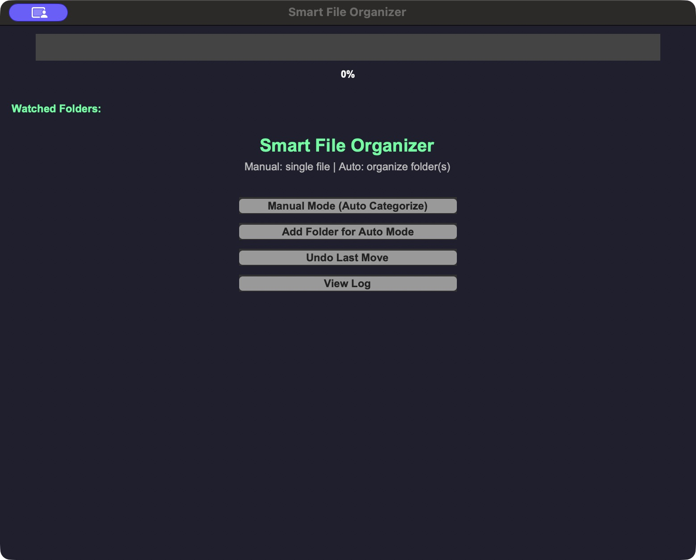

# Smart File Organizer

A desktop file organizer built with Python, Tkinter and a native C library. Sort a selected file, watch folders for incoming files, and undo successful moves without silently replacing an existing file.

[Build and test](https://github.com/amita7898/smart-file-organizer/actions/workflows/ci.yml) · [Install from source](#install-and-run-from-source) · [Safety](#collision-and-undo-safety) · [MIT License](LICENSE)



## Features

- Manual organization with extension and filename-keyword categories.
- Automatic folder scanning every two seconds using the native C organizer.
- Optional file drag-and-drop and folder registration through tkinterdnd2.
- Shared no-overwrite protection and a session undo stack for manual, dropped and automatic moves.
- Progress feedback, watched-folder controls and an in-memory session log.

## Requirements

Python 3.14 with Tkinter/Tk 8.6, a C compiler (Clang on macOS; GCC or Clang on Linux), and pip. The tested desktop is Apple Silicon macOS with Python 3.14.0. Linux has automated build/virtual-desktop test coverage through [GitHub Actions](https://github.com/amita7898/smart-file-organizer/actions/workflows/ci.yml); manual Linux desktop use has not been locally verified. Windows is not supported by this safety revision; the old Windows DLL is not distributed.

Use a Python distribution with working Tkinter. Check `python3 -m tkinter` before installation; do not try to install Tkinter with `pip install tk`. On macOS, the tested Python came from the standard python.org framework installation. A Homebrew Python installation may need its corresponding Tk package.

## Install and run from source

From the repository root:

```sh
python3 -m venv .venv
source .venv/bin/activate
python -m pip install -r requirements.txt
python scripts/build_native.py
python src/fileorganiser.py
```

On Linux, install the system Tk and compiler packages for your distribution first. The library is built for the current platform and architecture, so build it locally rather than copying a library from another machine. The application resolves its library relative to its source/bundle and can launch from a different working directory.

## Use

1. Try a disposable folder containing synthetic files first.
2. **Manual Mode** chooses one file and categorizes it. Keywords `report`, `project`, `assignment` map to Work; `photo`, `selfie`, `diary` map to Personal before extension rules.
3. **Add Folder for Auto Mode** watches a selected folder. Automatic native categories use extensions: Documents, Images, Videos, Music, Archives, Others. Automatic rules intentionally preserve the original native category mapping, which differs from manual rules.
4. **Stop Auto Mode** waits for the active scan to finish, stops scanning and clears watched folders.
5. **Undo Last Move** reverses the newest successful move when safe. Stop watching first if you want a restored file to stay in the watched folder.
6. **View Log** shows this session's move summaries. Closing the app clears logs and undo records.

Dropping files organizes them. Dropping a folder registers it; use Add Folder for Auto Mode to start scanning if scanning is stopped.

## Collision and undo safety

A same-name destination is **skipped**, including files, directories and symlinks. No automatic renaming, overwrite prompt or replacement occurs. Both originals remain available. Collision files remain in watched folders and will be skipped again on later scans.

Native moves use the platform's atomic exclusive rename operation. Unsupported filesystems/platform operations fail closed; there is no overwrite-capable fallback. Cross-filesystem moves are not supported. Symlink inputs and symlink category folders are rejected. A move into an existing category keeps that category's existing files.

Undo remembers the latest 100 successful moves in this session. It never overwrites a newly occupied source path and verifies the moved file's filesystem identity before restoring it. A refusal leaves the move available for retry. It cannot restore overwritten data from earlier versions, undo changes after an app restart, or protect files against changes by other programs. This is an organizer, not a backup or a sandbox against hostile concurrent directory manipulation. Keep normal backups.

## Tests

```sh
python scripts/build_native.py
python -m unittest discover -s tests -v
# On a graphical desktop, also exercise the actual Tk interface:
GUI_TESTS=1 python -m unittest discover -s tests -v
```

The suite uses temporary synthetic files only. It covers collisions, undo identity checks and retries, symlinks, long paths, competing moves, Unicode names, automatic scans, and Tk manual/drop/watch controls. Headless runs skip six GUI tests. Local validation on macOS: all **25 tests passed**, comprising 19 core tests and six GUI tests. CI runs all 25 under Xvfb on Linux; its macOS job runs the 19 native/core cases (six GUI cases intentionally unselected) and verifies the bundle build. Consult the linked workflow for actual run results.

## Downloads

This publication is **source-only**. No tested standalone application download is offered yet. The earlier local macOS bundle has development metadata and is not a verified distributable; CI build success alone does not make a binary release. Follow the source setup above or build locally using the instructions that follow.

## Build a desktop bundle

```sh
python -m pip install -r requirements-build.txt
python scripts/build_native.py
python -m PyInstaller packaging/fileorganiser.spec
```

The macOS app is `dist/Smart File Organizer.app`; Linux produces a directory executable. PyInstaller must run on the target platform. Python/Tk, compiler and architecture influence output; the build is repeatable from declared inputs, not claimed to be byte-identical across toolchains.

On macOS, build outside iCloud/File Provider folders if signing reports Finder metadata. For example:

```sh
bundle_dir=$(mktemp -d /private/tmp/organizer-build.XXXXXX)
PYINSTALLER_CONFIG_DIR="$bundle_dir/cache" python -m PyInstaller   --workpath "$bundle_dir/build" --distpath "$bundle_dir/dist" packaging/fileorganiser.spec
```

Ad-hoc local builds are not Developer ID signed or notarized. Do not distribute them as trusted signed releases. Native libraries, build outputs and packaged runtimes are intentionally ignored by Git.

## Project layout

```text
src/fileorganiser.py       Tk interface and original manual category rules
src/organizer_core.py      Serialized Python/native operations
native/fileorg2.c          Original native categories, safe moves and undo
scripts/build_native.py   Current-platform C build
packaging/                 Portable PyInstaller specification
tests/                     Disposable native and GUI regression tests
docs/                      Provenance, demo instructions and screenshots
```

See [demo instructions](docs/DEMO.md), [provenance and changes](docs/PROVENANCE.md) and [MIT License](LICENSE). The original college project is preserved separately; this repository begins a clean source-first history.
